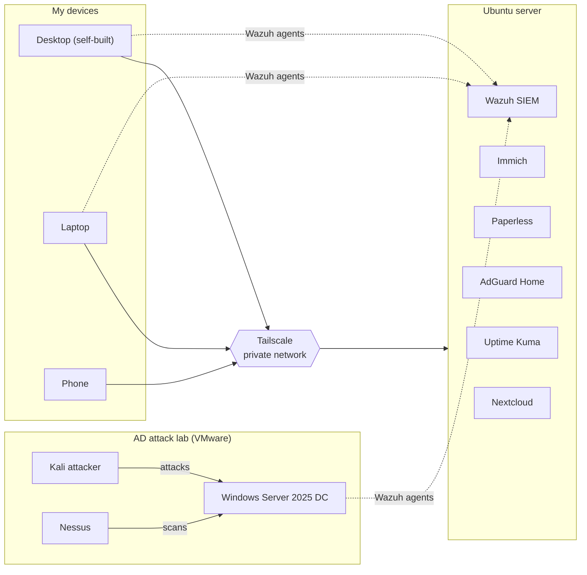

# Homelab

**A self-hosted Ubuntu server, a Wazuh SIEM watching every machine I own, and an Active Directory lab I build, attack, and defend.**

[← Back to my profile](https://github.com/liamskillern)

---

## Why I built it

I learn security best by running the systems myself. Reading about a SIEM is one thing; tuning one that is watching your own laptop is another. This lab is where I practice the work a SOC analyst or systems administrator does every day: running services, monitoring them, keeping them private, and seeing what an attack looks like from both sides.

## At a glance

| | |
|---|---|
| **Server** | Ubuntu Server, self-hosted at home |
| **Remote access** | Tailscale only. No ports are open to the internet |
| **Monitoring** | Wazuh SIEM with agents on my desktop, laptop and lab domain controller |
| **Uptime** | Uptime Kuma checks every service |
| **DNS** | AdGuard Home filters ads, trackers and known-bad domains for the network |
| **Attack lab** | Windows Server 2025 domain controller, Kali attacker and Nessus in VMware Workstation |

## Architecture

## The services

| Service | What it does for me | Why it matters for security |
|---|---|---|
| **Nextcloud** | My own file sync and storage | I control where my data lives and who can reach it |
| **Immich** | Self-hosted photo backup from my phone | Replaces a cloud service with one I patch and back up myself |
| **Paperless** | Scans and indexes documents | Practice handling sensitive files on hardware I own |
| **AdGuard Home** | Network-wide DNS filtering | Blocks trackers and malicious domains before they load |
| **Uptime Kuma** | Status checks on every service | I find out something broke before I need it |
| **Wazuh** | SIEM and endpoint monitoring | File integrity, log analysis and alerts across my machines |

## How it is secured

- **Nothing faces the internet.** Every service is reached through Tailscale, a private WireGuard-based network. There is no port forwarding on my router, so there is nothing for an internet scanner to find.
- **Everything is watched.** Wazuh agents report from my desktop, laptop and the lab domain controller, so I can see logins, file changes and suspicious activity in one place.
- **Filtering at DNS.** AdGuard Home blocks known tracking and malicious domains for every device on the network.
- **Monitoring that tells me first.** Uptime Kuma alerts me when a service goes down.
- **Lab kept apart.** The attack lab runs as VMs in VMware Workstation, separate from the services I rely on.

## Active Directory attack lab

The goal is simple: **build it, attack it, detect it.**

1. **Build.** A Windows Server 2025 domain controller with users, groups and policies like a small company would have.
2. **Attack.** A Kali Linux VM runs common Active Directory attacks against the domain.
3. **Scan.** Nessus scans the domain controller for vulnerabilities and misconfigurations.
4. **Detect.** The domain controller sends its logs to Wazuh, so I can check which attacks raise an alert and which slip through.

That last step is the one I care about most. An attack you can run but can't detect only teaches half the lesson.

*Full write-up of the attacks and detections is in progress.*

## Skills this lab builds

- Linux server administration (Ubuntu)
- Windows Server and Active Directory administration
- SIEM deployment and log analysis with Wazuh
- Vulnerability scanning with Nessus
- Offensive testing with Kali Linux
- Zero-trust style remote access with Tailscale
- DNS security and filtering
- Service monitoring and self-hosting
- Virtualization with VMware Workstation

## What's next

- [ ] Publish the Active Directory attack and detection write-up
- [ ] Write custom Wazuh rules for the attacks the defaults miss
- [ ] Document my backup and restore process
- [ ] Map the lab to CompTIA Security+ (SY0-701) objectives as I study

---

Built and maintained by [Liam Skillern](https://github.com/liamskillern) · Cybersecurity student at CSU Pueblo · [LinkedIn](https://www.linkedin.com/in/liam-skillern/)

